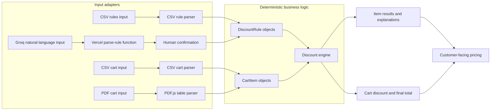

# Opptra Discount Engine

An implementation of the Opptra FDE Intern assignment: a customer-facing pricing application that converts uploaded cart and offer data into transparent final prices. Accurate pricing is the central concern: item-level offers are resolved deterministically, cart-level offers are applied only after item pricing, and the result explains why every saving was selected.

The application supports CSV and PDF cart ingestion, as well as Groq-assisted natural-language creation of discount rules. Input adapters turn those sources into standard `DiscountRule` and `CartItem` objects; the deterministic engine is kept separate so pricing is independent of how data entered the application.

## Features

### Discount engine

- Brand and platform offers with percentage and flat discount types.
- Greatest rupee saving selected among matching non-stackable offers.
- Sequential application of matching stackable offers.
- Cart-level percentage offers with minimum-cart-value thresholds.
- Item and cart totals never fall below zero.
- Case-insensitive, whitespace-normalized exact matching for brands and platforms.
- Customer-facing explanations for applied and unavailable offers.

### Groq AI rule creation

- Natural-language discount instructions converted to structured rules.
- Groq Structured Outputs with server-side semantic validation.
- User confirmation or discard before an AI-generated rule becomes active.
- Duplicate prevention and automatic recalculation after confirmation.
- Server-side API-key handling; the key is never bundled into the frontend.

### PDF cart upload

- Browser-side PDF.js extraction of text-based cart PDFs.
- Coordinate-based table reconstruction and currency normalization.
- Conversion from PDF rows into standard `CartItem` objects.
- Partial import with detailed, row-level warnings.
- Automatic recalculation after a successful import.

### Additional functionality

- CSV rules and cart uploads.
- Individual discount-rule deletion.
- Automated regression and integration-style tests.
- Error states for malformed files, invalid rules, and unavailable AI configuration.

## Technology stack

- React 18.2
- JavaScript ES modules
- Vite 5
- PapaParse 5.4
- Mozilla PDF.js (`pdfjs-dist` 6.5)
- Groq API
- Vercel Functions
- Node.js built-in test runner (`node --test`)

## Architecture



The engine is deliberately deterministic. Adapters parse and validate input, but the engine alone selects offers, applies discounts, rounds values, and creates the final pricing result.

## Important engineering decisions

### Deterministic pricing

Groq interprets a natural-language offer into a candidate rule; it does not calculate prices. The existing discount engine makes every pricing decision from validated `DiscountRule` and `CartItem` data, making results reproducible and testable.

### Human confirmation

An AI-generated candidate is shown for confirmation before it is added to active rules. A user can discard it, and duplicate rules are rejected before the cart is recalculated.

### Partial PDF imports

Each PDF row is validated independently. When at least one product row is valid, the cart is replaced with only the accepted products and every invalid row is reported with row-level detail. When zero rows are valid, headers are missing, or the PDF cannot be read, the existing cart remains unchanged.

This trade-off permits a usable cart despite isolated malformed records while making omissions visible to the user. It avoids silently accepting an entirely invalid upload or replacing the cart with no valid products.

### Currency rounding

Percentage discount amounts are rounded to whole rupees at each application. Flat discounts and each resulting price are capped at the remaining balance, so no item or cart total can become negative.

### Multiple cart rules

Eligibility for every cart rule is evaluated against the original subtotal after item-level discounts. The eligible non-stackable rule with the largest rupee saving wins; eligible stackable rules then apply sequentially to the remaining total in deterministic input order.

## Run locally

Use Vercel’s local development workflow for the complete application, including the serverless Groq endpoint.

1. Install dependencies: `npm install`
2. Create `.env.local` from `.env.example` and configure it:

   ```env
   GROQ_API_KEY=
   GROQ_MODEL=openai/gpt-oss-20b
   ```

3. Start the application: `npm run dev:vercel`

Groq rule creation requires a valid server-side `GROQ_API_KEY`. `npm run dev` starts Vite only and does not execute the Vercel API function. The local URL is reported by the Vercel CLI, commonly `http://localhost:3000`.

## CSV formats

### `rules.csv`

| Column | Type | Example |
|---|---|---|
| `rule_id` | string | `RULE-01` |
| `scope` | `brand`, `platform`, or `cart` | `platform` |
| `applies_to` | string; required for brand/platform | `Amazon India` |
| `type` | `percentage` or `flat` | `percentage` |
| `value` | positive number | `15` |
| `stackable` | `true` or `false` | `false` |
| `min_cart_value` | positive number; required for cart | `4000` |

### `cart.csv`

| Column | Type | Example |
|---|---|---|
| `item_id` | string | `ITEM-01` |
| `product` | string | `Cushion Cover` |
| `brand` | string | `Natura Casa` |
| `platform` | string | `Amazon India` |
| `base_price` | positive number | `1299` |

## Sample results

With the supplied CSV fixtures, item-level results produce a ₹5,932 subtotal. The eligible 10% cart offer saves ₹593, leaving a final cart total of ₹5,339.

## Testing

Run the automated suite and production build:

```bash
npm test
npm run build
```

The suite currently contains 30 tests covering discount selection and rounding, cart thresholds and validation, case/whitespace matching, non-negative totals, CSV parsing, PDF extraction and partial imports, upload state, rule deletion, and mocked Groq API responses. Groq tests do not make live requests; successful live Groq parsing still depends on a valid configured key and provider access.

Regenerate the deterministic PDF fixtures with:

```bash
python scripts/generate-test-pdfs.py
```

The fixtures are:

- `sample-data/sample-cart.pdf` — six valid cart rows.
- `sample-data/sample-cart-invalid.pdf` — a matching table with one invalid base price for partial-import feedback testing.

## Known limitations

- OCR is unsupported; scanned/image-only PDFs are rejected.
- Complex or irregular PDF table layouts may be rejected.
- Groq requires a valid API key and remains subject to provider availability and rate limits.
- PDF.js increases the client-side bundle size.
- Application data is held in session-only memory; there is no database persistence.

## Live Demo

Deployment pending — live URL will be added after production verification.

For a Vercel deployment, add `GROQ_API_KEY` and `GROQ_MODEL=openai/gpt-oss-20b` in **Project Settings → Environment Variables** for each environment that should support AI rule creation: Development, Preview, and Production. Never commit a real key. Replace the placeholder above only with the verified production URL.

## Submission materials

- **GitHub repository:** include this repository after the intended source, fixtures, tests, lockfile, and documentation are committed.
- **Deployed application:** pending production verification; add the verified URL in the Live Demo section.
- **Loom walkthrough:** pending recording; demonstrate CSV/PDF upload, calculated pricing, cart discount, and AI-rule confirmation.
- **Sample files:** `sample-data/rules.csv`, `sample-data/cart.csv`, and both PDF fixtures listed above.
