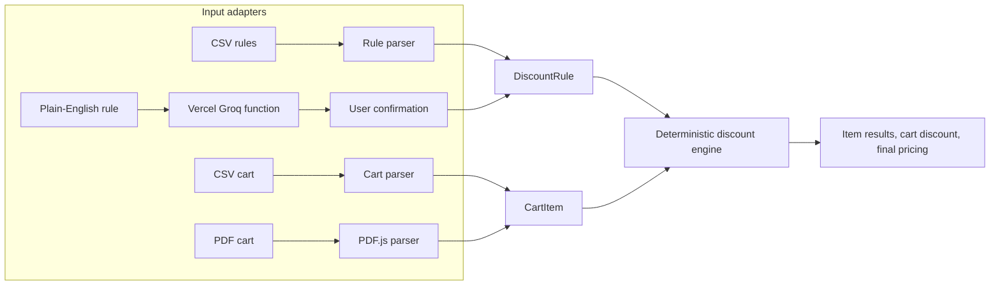

# Opptra Discount Engine

[](#live-demo)
[](#loom-walkthrough)

This project implements the Opptra FDE Intern assignment: a customer-facing tool for applying discount rules to uploaded shopping carts accurately and transparently. It combines deterministic item- and cart-level pricing with optional AI-assisted rule creation and PDF cart ingestion, while keeping business calculations independent from input sources.

## Application preview

No current-application screenshots are stored in this repository. Add verified screenshots here after deployment, showing the uploaded cart, calculated summary, and AI-rule confirmation flow.

## Key capabilities

### Deterministic discount engine

- Brand and platform rules with percentage or flat discounts.
- Largest rupee saving selected among matching non-stackable item offers.
- Stackable item offers applied sequentially to the remaining price.
- Cart-level percentage offers evaluated after item-level pricing.
- Normalized, case-insensitive exact matching for brand and platform names.
- Whole-rupee rounding and protection against negative item or cart totals.
- Customer-facing explanations for applied offers.

### Natural-language rule creation using Groq

- Turns a plain-English instruction into a structured candidate rule.
- Uses structured JSON output plus semantic rule validation.
- Requires confirmation before a generated rule becomes active.
- Prevents duplicate active rules and recalculates after confirmation.
- Keeps the Groq API key server-side in the Vercel function.

### PDF cart ingestion

- Extracts text-based PDFs in the browser with PDF.js.
- Reconstructs product tables from text coordinates and normalizes prices.
- Converts accepted rows into standard `CartItem` objects.
- Supports partial import with detailed row-level warnings.
- Recalculates automatically after a successful PDF import.

### CSV uploads and rule management

- Loads discount rules and carts from CSV.
- Displays validated rules, cart items, and calculated results.
- Allows individual active rules to be deleted for the current session.
- Preserves the source CSV; deletion does not edit uploaded files.

## How to try the application

1. Load `sample-data/rules.csv` in the **Discount Rules** uploader.
2. Load `sample-data/cart.csv` in the **Cart Items** uploader.
3. Select **Calculate Discounts** to view item prices, cart savings, and final total.
4. In **Create Discount Using AI**, enter an instruction (or choose an example), then select **Parse Rule**.
5. Review the candidate and choose **Confirm Rule** or **Discard**.
6. Upload `sample-data/sample-cart.pdf` to import the valid six-item PDF cart.
7. Upload `sample-data/sample-cart-invalid.pdf` to inspect the row-level warning and partial-import behavior.
8. Delete an active rule from the rules table and observe recalculation.

## Example pricing results

The supplied CSV fixtures produce these verified item-level results:

| Item | Product | Base price | Final price | Applied result |
|---|---|---:|---:|---|
| ITEM-01 | Cushion Cover | ₹1,299 | ₹1,104 | 15% Amazon India offer |
| ITEM-02 | Bed Sheet Set | ₹849 | ₹629 | ₹150 brand offer, then 10% Flipkart offer |
| ITEM-03 | Wall Shelf | ₹599 | ₹509 | 15% Amazon India offer |
| ITEM-04 | Ceramic Vase | ₹2,499 | ₹2,499 | No offer |
| ITEM-05 | Cutting Board | ₹449 | ₹382 | 15% Amazon India offer |
| ITEM-06 | Desk Organiser | ₹899 | ₹809 | 10% Flipkart offer |

| Summary | Amount |
|---|---:|
| Item subtotal | ₹5,932 |
| Cart discount | −₹593 |
| Final cart total | ₹5,339 |

## Pricing and business logic

- For a matching item, the non-stackable rule with the largest applicable rupee saving wins. Savings are capped at the remaining price, so ties retain deterministic input order.
- Matching stackable item rules apply one at a time to the remaining price.
- Cart rules run after all item-level discounts. Their minimum-cart-value eligibility is checked against that post-item-discount subtotal.
- Among eligible non-stackable cart rules, the largest saving wins. Eligible stackable cart rules then apply sequentially in input order; all thresholds are evaluated against the original item-level subtotal.
- Percentage discounts are rounded to whole rupees as each rule is applied. Every discount is capped at the remaining balance, preventing negative prices.

## Architecture



Groq only interprets discount language into a candidate rule. The deterministic engine validates the active data and calculates all prices, which keeps outcomes repeatable, testable, and independent of the LLM.

## Engineering decisions

### Human confirmation and server-side credentials

AI-generated rules are not activated automatically: users must confirm them, or discard them. The browser calls `/api/parse-rule`; only the Vercel function reads `GROQ_API_KEY`, so the secret is not embedded in the frontend bundle or returned to the browser.

### Partial PDF imports

Rows are validated independently. If at least one product is valid, the cart is replaced with accepted rows and every rejected row is reported. If no rows are valid, headers are missing, or a PDF is unreadable, the current cart remains unchanged.

This favors processing a usable cart despite isolated malformed rows while retaining transparency through detailed warnings. It avoids replacing a valid cart with an empty or wholly invalid import.

### Validation and errors

CSV rules, cart rows, PDF rows, direct cart-rule inputs, and AI responses are validated before they affect pricing. Invalid data is surfaced as an error or warning rather than silently converted into a valid-looking rule or price.

## Technology stack

| Technology | Use |
|---|---|
| React 18.2 | User interface |
| JavaScript ES modules | Application code |
| Vite 5 | Development and production build |
| PapaParse 5.4 | CSV parsing |
| PDF.js 6.5 | Browser-side PDF text extraction |
| Groq API | Natural-language rule interpretation |
| Vercel Functions | Server-side Groq endpoint |
| Node.js built-in test runner | Automated tests |

## Run locally

Use Vercel’s local development workflow so the React app and Vercel API function run together.

1. Install dependencies: `npm install`
2. Create `.env.local` from `.env.example` and configure:

   ```env
   GROQ_API_KEY=
   GROQ_MODEL=openai/gpt-oss-20b
   ```

3. Start the complete application: `npm run dev:vercel`

`GROQ_API_KEY` must be a valid server-side key for AI rule creation. `npm run dev` starts Vite only; it does not run the Vercel API function.

## Testing

```bash
npm test
npm run build
```

The current suite contains **31 tests** covering discount selection, cart thresholds, parser validation, matching normalization, non-negative prices, PDF extraction and partial imports, upload state, rule deletion, and mocked Groq API behavior. Groq tests use mocked requests; no successful live Groq request is claimed.

Regenerate the PDF fixtures with:

```bash
python scripts/generate-test-pdfs.py
```

## Known limitations

- OCR is unsupported; scanned or image-only PDFs are rejected.
- Complex or irregular PDF table layouts may be rejected.
- Groq requires a valid key and is subject to provider availability and limits.
- PDF.js increases the client-side bundle size.
- State is session-only and is not persisted to a database.

## Submission links

- **Production URL:** outstanding — add only after production verification.
- **Loom walkthrough:** outstanding — add only after recording.
- **Sample files:** `sample-data/rules.csv`, `sample-data/cart.csv`, `sample-data/sample-cart.pdf`, and `sample-data/sample-cart-invalid.pdf`.

## Live Demo

Status: Awaiting production deployment.

Production URL: TODO — replace with verified URL.

## Loom Walkthrough

Status: Awaiting recording.

Video URL: TODO — replace with verified Loom share URL.

For Vercel deployment, configure `GROQ_API_KEY` and `GROQ_MODEL` in Project Settings → Environment Variables for Development, Preview, and Production. Never commit a real API key.
